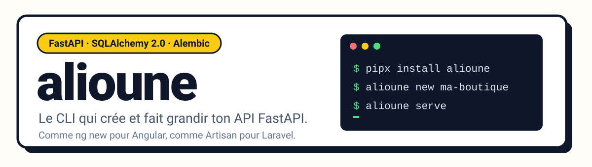
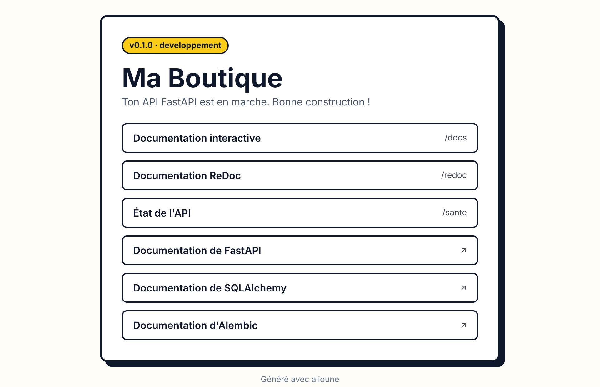
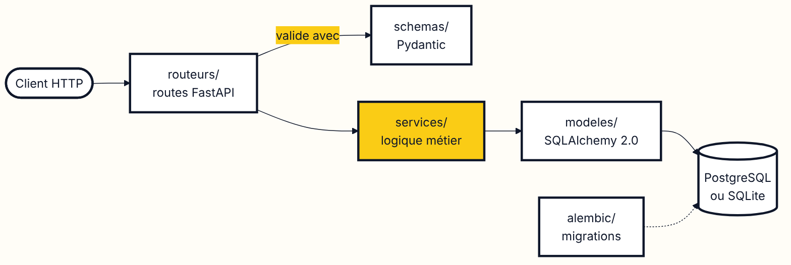
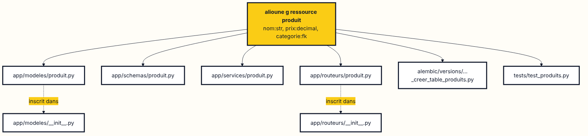

<p align="center">
  
</p>

<p align="center">
  <a href="https://pypi.org/project/alioune/"></a>
  <a href="https://pypi.org/project/alioune/"></a>
  <a href="https://github.com/Aliounecode/alioune-cli/actions/workflows/tests.yml"></a>
  <a href="https://github.com/Aliounecode/alioune-cli/blob/main/LICENSE"></a>
</p>

**alioune** crée un projet FastAPI **qui fonctionne dès le premier `uvicorn`**, puis génère le code de chaque nouvelle fonctionnalité (modèle, schémas, service, routes, migration, tests). C'est l'idée de `ng new` / `ng generate` d'Angular et de `php artisan` de Laravel, appliquée à FastAPI, avec du code **en français** et les API à jour de SQLAlchemy 2.0.



## Pourquoi alioune ?

FastAPI est volontairement minimal : pas de dossier imposé, pas de générateur. Chacun recommence la même structure à chaque projet. alioune apporte ce que les autres frameworks offrent d'office.

| Tu veux… | Angular | Laravel | **alioune** |
|---|---|---|---|
| Créer un projet prêt à l'emploi | `ng new` | `laravel new` | `alioune new` |
| Lancer le serveur | `ng serve` | `php artisan serve` | `alioune serve` |
| Générer du code | `ng generate` | `php artisan make:model -mcr` | `alioune g ressource` |
| Appliquer les migrations | — | `php artisan migrate` | `alioune migrate` |
| Ajouter l'authentification | — | Breeze | `alioune auth` |

## Installation

```bash
pipx install alioune        # recommandé : la commande est disponible partout
# ou
pip install alioune
```

Il faut Python 3.10 ou plus. Pour une base PostgreSQL (par défaut), le serveur doit être installé ; sans serveur, utilise `--base sqlite`.

## Démarrage rapide

```bash
alioune new ma-boutique --base sqlite
cd ma-boutique
alioune serve
```

Ouvre <http://127.0.0.1:8000> : la page d'accueil du projet s'affiche, avec les liens vers la documentation interactive de l'API.

<p align="center">
  
</p>

`alioune new` fait tout le travail de départ : dossier, environnement virtuel `.venv`, dépendances, fichier `.env` avec une clé secrète aléatoire, dépôt Git, migrations Alembic prêtes et tests qui passent.

## Ce que tu obtiens

```
ma-boutique/
├── app/
│   ├── main.py                 point d'entrée FastAPI (CORS, routeurs)
│   ├── config.py               paramètres lus depuis .env (pydantic-settings)
│   ├── base_de_donnees.py      moteur et sessions SQLAlchemy 2.0
│   ├── modeles/                tables (SQLAlchemy)
│   ├── schemas/                validation et réponses (Pydantic)
│   ├── services/               logique métier
│   ├── routeurs/               routes : accueil, /sante, /api/...
│   └── gabarits/accueil.html   la page d'accueil
├── alembic/                    migrations
├── tests/                      pytest, avec base SQLite en mémoire
├── .env  .env.example  .gitignore
└── requirements.txt  requirements-dev.txt  alembic.ini  pytest.ini
```

Une requête traverse toujours les mêmes couches, et chaque couche a un seul rôle :



## Générer du code

```bash
alioune g ressource produit -c "nom:str,prix:decimal,description:text?,actif:bool"
alioune migrate
```

Une **ressource** crée en une commande tout ce qu'il faut pour exposer une table : liste paginée, lecture, création, modification partielle (PATCH) et suppression. Le modèle et le routeur sont inscrits automatiquement.



| Type | Ce qui est généré |
|---|---|
| `ressource` | modèle, schémas, service, routeur, migration, tests |
| `modele`, `schema`, `service`, `routeur` | un seul fichier (avec inscription quand il le faut) |
| `migration` | une migration vide, rattachée à la précédente |
| `config` | une classe de paramètres (`pydantic-settings`) et les variables dans `.env` |

**Options :** `-c` / `--champs`, `--pluriel` (si le pluriel automatique se trompe), `--protege` (route réservée aux utilisateurs connectés), `--simuler` (affiche sans écrire), `--force` (remplace les fichiers existants). Sans `--force`, rien n'est jamais écrasé.

### Les champs

`nom:type`, avec `?` à la fin pour un champ facultatif.

| Type | Python | Colonne SQL |
|---|---|---|
| `str` | `str` | `String(255)` |
| `text` | `str` | `Text` |
| `int` | `int` | `Integer` |
| `float` | `float` | `Float` |
| `decimal` | `Decimal` | `Numeric(12, 2)` : adapté aux montants en FCFA |
| `bool` | `bool` | `Boolean` |
| `date` | `date` | `Date` |
| `datetime` | `datetime` | `DateTime(timezone=True)` |
| `fk` | `int` | clé étrangère vers un autre modèle (voir ci-dessous) |

### Recherche, tri et filtres

Les listes générées acceptent tout de suite :

```
GET /api/produits?q=riz                    # recherche dans les champs texte (str, text)
GET /api/produits?tri=-prix                # tri décroissant (préfixe -)
GET /api/produits?actif=true&categorie_id=3  # filtres sur les champs bool et les relations fk
GET /api/produits?q=riz&tri=nom&saut=20&limite=20
```

- La recherche ignore la casse et traite `%` et `_` comme des caractères ordinaires.
- `tri` n'accepte que les champs du modèle (plus `id`, `cree_le`, `modifie_le`) ; un autre nom renvoie 422.
- Les paramètres apparaissent dans la documentation Swagger (`/docs`).

### Les relations entre tables

```bash
alioune g ressource categorie -c "nom:str"
alioune g ressource fournisseur -c "nom:str"
alioune g ressource produit -c "nom:str,prix:decimal,categorie:fk,fournisseur:fk?"
```

- `categorie:fk` crée la colonne `categorie_id`, la clé étrangère vers `categories.id`, un index et la relation `produit.categorie`.
- `origine:fk(pays)` vise un modèle dont le nom diffère de celui du champ.
- **Obligatoire** (`categorie:fk`) : on ne peut pas supprimer une catégorie encore utilisée (`409`). **Facultative** (`fournisseur:fk?`) : si le fournisseur disparaît, le produit est conservé avec `fournisseur_id` à `null`.
- L'API répond `422` si on référence un élément qui n'existe pas, et `409` si une suppression est refusée.
- Génère d'abord le modèle lié : sa migration doit passer avant celle du produit. alioune te prévient si ce n'est pas le cas.
- Relation vers les comptes : `proprietaire:fk(utilisateur)` après `alioune auth`.

Deux autres formes de relation :

```bash
# Plusieurs-à-plusieurs : table d'association, champ `etiquettes_ids` dans l'API
alioune g ressource etiquette -c "nom:str"
alioune g ressource produit -c "nom:str,prix:decimal,etiquettes:m2m(etiquette)"

# Hiérarchie : un modèle qui pointe vers lui-même (le parent est facultatif)
alioune g ressource categorie -c "nom:str,parent:fk(categorie)?"
```

- `m2m(modele)` crée la table d'association (clés étrangères en `CASCADE`, clé primaire composée) dans le modèle et dans la migration. L'API lit et écrit la liste d'identifiants (`etiquettes_ids`) et refuse (422) un identifiant inconnu.
- La cible d'un `m2m` doit être indiquée, et il faut au moins un champ simple dans le modèle.
- Supprimer un parent n'efface pas ses enfants : leur `parent_id` passe à `NULL`.

## Authentification (optionnelle)

Si tu as ta propre authentification, ne lance rien. Sinon :

```bash
alioune auth
alioune migrate
python -m app.creer_admin admin@exemple.com
alioune g ressource commande -c "reference:str" --protege
```

Cela installe : le modèle `Utilisateur`, le hachage Argon2, des jetons JWT, les routes `POST /api/auth/inscription`, `POST /api/auth/connexion` et `GET /api/auth/moi`, les dépendances `UtilisateurCourant`, `UtilisateurAdmin` et `exiger_role(...)`, la migration et les tests. Le code est ajouté **dans ton projet** : il t'appartient, modifie-le librement.

L'authentification fournie ne limite pas encore le nombre de tentatives de connexion et n'a pas de jeton de rafraîchissement : à compléter avant une mise en production.

## Toutes les commandes

| Commande | Rôle |
|---|---|
| `alioune new <nom>` | Crée un projet (`--base postgresql\|sqlite`, `--sans-installation`, `--sans-git`) |
| `alioune generate <type> <nom>` (`g`) | Génère du code |
| `alioune auth` | Installe l'authentification |
| `alioune serve` | Lance uvicorn avec rechargement (`--port`, `--hote`) |
| `alioune migrate` | Applique les migrations (`--annuler` revient en arrière) |
| `alioune routes` | Liste les routes de l'API |
| `alioune info` | Affiche les informations du projet |

Les commandes `g`, `auth`, `serve`, `migrate`, `routes` et `info` se lancent depuis un projet créé avec `alioune new`.

## Questions fréquentes

**La base PostgreSQL n'existe pas / la connexion échoue.** Crée la base (`createdb ma_boutique`) et ajuste `DATABASE_URL` dans `.env` (utilisateur, mot de passe, port). Pour commencer sans serveur : `alioune new ma-boutique --base sqlite`. Même sans base, l'API démarre et `/sante` indique `base_de_donnees: indisponible`.

**`alioune` n'est pas reconnu après l'installation.** Lance `pipx ensurepath`, puis rouvre le terminal.

**Puis-je l'utiliser sur un projet FastAPI existant ?** alioune est conçu pour les projets créés avec `alioune new` : il retrouve le projet grâce au fichier `alioune.json` et s'appuie sur la structure ci-dessus.

## Contribuer

Les gabarits sont de simples fichiers Jinja2 : ajouter un type de génération ou améliorer le code produit est accessible. Le guide est dans [CONTRIBUTING.md](https://github.com/Aliounecode/alioune-cli/blob/main/CONTRIBUTING.md).

```bash
git clone https://github.com/Aliounecode/alioune-cli.git
cd alioune-cli
python -m venv .venv && source .venv/bin/activate    # Windows : .venv\Scripts\activate
pip install -e ".[dev]"
pytest
```

## Licence

[MIT](https://github.com/Aliounecode/alioune-cli/blob/main/LICENSE) · créé à Dakar par [Alioune](https://github.com/Aliounecode).
